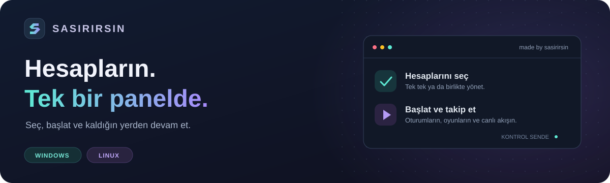
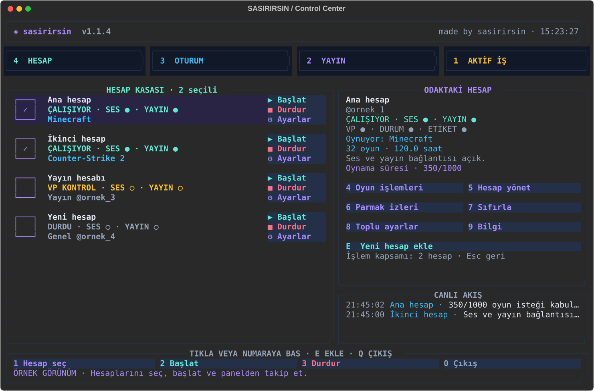
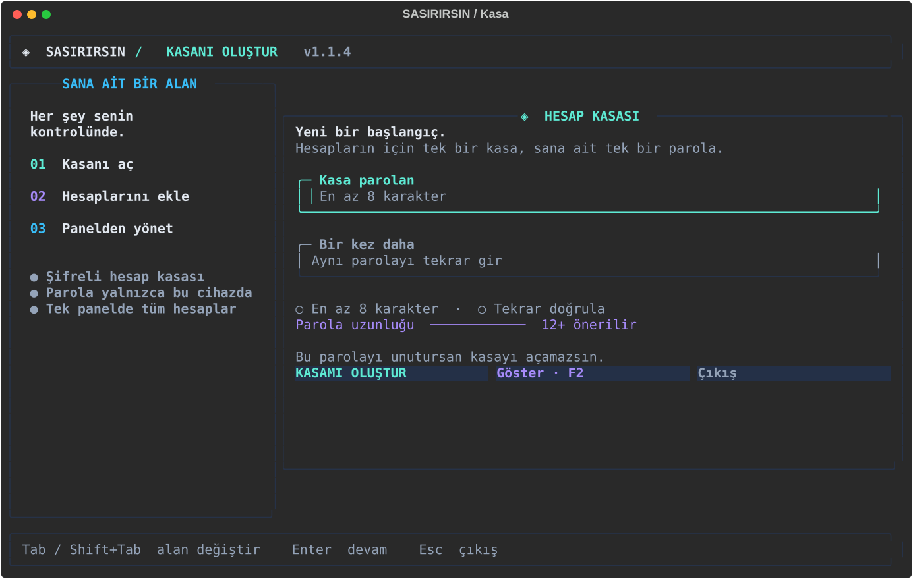

<div align="center">



<br>

**[Windows için indir ↗](https://github.com/nurshia/sarisinsin/releases/latest/download/sasirirsin-windows-x64-standalone.zip)** &nbsp; · &nbsp; **[Linux için indir ↗](https://github.com/nurshia/sarisinsin/releases/latest/download/sasirirsin-linux-x64-standalone.zip)** &nbsp; · &nbsp; [Son sürüm ve yenilikler](https://github.com/nurshia/sarisinsin/releases)

[Kurulum](#kurulum) &nbsp; / &nbsp; [Paneli kullan](#panel) &nbsp; / &nbsp; [Toplu yönetim](#toplu) &nbsp; / &nbsp; [Oyunlar](#oyunlar) &nbsp; / &nbsp; [Güncelleme](#guncelleme) &nbsp; / &nbsp; [Yardım](#yardim)

</div>

---

Discord hesaplarını kendi bilgisayarında tek bir yerden yönet. Bir hesabı başlatırken diğerlerini açık tut, oyun seçeneklerini düzenle ve oturumların durumunu aynı ekrandan takip et. **Fareyle tıkla veya klavyeyle devam et.**

| Hesap kasası | Toplu kontrol | Canlı takip |
| :--- | :--- | :--- |
| Hesaplarını adlandır, gruplara ayır ve parolanla aç. | Tek hesabı, birkaç hesabı veya görünen hesapların tamamını yönet. | Ses, yayın ve işlem durumlarını panelden takip et. |

<div align="center">



<sub>Uygulamanın örnek hesaplarla panel görünümü.</sub>

</div>

<a id="kurulum"></a>

## Başlamak için

### 01 · Uygulamayı aç

| Windows | Linux |
| :--- | :--- |
| Üstteki **Windows için indir** bağlantısını kullan. | Üstteki **Linux için indir** bağlantısını kullan. |
| ZIP'i bir klasöre çıkar. | ZIP'i bir klasöre çıkar. |
| Klasördeki **sasirirsin.exe** dosyasını aç. | Klasör içinde terminal açıp aşağıdaki komutları çalıştır. |

```bash
chmod +x sasirirsin.bin
./sasirirsin.bin
```

Uygulamanın yanında gelen dosyaları aynı klasörde tut. Sonraki açılışlarda da aynı klasörden çalıştır.

### 02 · Kasanı oluştur

İlk açılışta **en az 8 karakterlik bir parola** belirle ve tekrar gir. **Kasamı oluştur** düğmesine tıkla. Sonraki açılışlarda bu parolayla kayıtlı hesaplarına ulaşırsın.

Ekrandaki [YouTube](https://www.youtube.com/@wraithsdev) ve [Discord](https://discord.gg/vp) adımlarını tamamlayıp panele geç.

<details>
<summary><strong>İlk açılış ekranını göster</strong></summary>

<br>



</details>

### 03 · İlk hesabını ekle

**Yeni hesap ekle** düğmesine tıkla veya **E** tuşuna bas. Hesabına kolay ayırt edeceğin bir ad ver, token alanını doldur ve **Kaydet** seçeneğini kullan.

| Alan | Nasıl doldurulur? |
| :--- | :--- |
| **Hesap adı** | Listede görmek istediğin ad. Örneğin: Ana hesap. |
| **Grup** | Hesaplarını ayırmak için kullanabilirsin. Varsayılanı bırakabilirsin. |
| **Yayın dosyası** | Kendi yayın dosyanı seçmek istersen doldur. Boş bırakırsan uygulamanın görseli kullanılır. |
| **Token** | Eklemek istediğin hesabın token değeri. |
| **Çerez** | İsteğe bağlıdır; ihtiyaç duymuyorsan boş bırak. |

Kaydettiğinde hesap listeye eklenir ve oturumu başlatılır.

> Başlatacağın hesabın **[discord.gg/vp](https://discord.gg/vp)** sunucusunda bulunması gerekiyor.

<a id="panel"></a>

## Panelde neler var?

### Solda hesapların, sağda seçtiğin hesap

Hesabın adına tıkladığında sağdaki **Odaktaki Hesap** alanında bilgilerini görürsün. Bir menü açtığında seçenekler bu alanda görünür; hesap listesi ve canlı akış ekranda kalır.

Her hesabın yanında üç düğme bulunur:

| Düğme | İşlem |
| :--- | :--- |
| **▶ Başlat** | O hesabın oturumunu başlatır. |
| **■ Durdur** | O hesabın oturumunu durdurur. |
| **⚙ Ayarlar** | Yalnızca o hesabın ayarlarını açar. |

**Başka bir hesaba geçmek açık oturumlarını durdurmaz.** Hesabı durdurana veya uygulamadan çıkana kadar çalışmaya devam eder.

### Ayarlarını düzenle

**Hesap yönet** ile hesap ekleyebilir, mevcut hesaplarını düzenleyebilir, adlarına göre arayabilir ve gruplarını filtreleyebilirsin. Bir dosyadan birden fazla hesap ekleme seçeneği de burada bulunur.

Düzenleme ekranında kayıtlı bilgilerin hazır gelir. Yalnızca değiştirmek istediğin alanı düzenle. **Token ve çerez alanları boş görünür; boş bırakırsan kayıtlı değerler korunur.** Hesap bilgilerini değiştirmeden önce ilgili hesabı durdur.

Alanlar arasında **Tab / Shift+Tab** ile geçebilir veya doğrudan alana tıklayabilirsin.

### Oturumunu takip et

Başlatılan hesap, VP sunucusundaki **vsc** ses kanalına mikrofonu kapalı şekilde katılır ve yayın başlatılır. Sunucu etiketi ayarlanır; durum yazının başına **.gg/vp** eklenir. Mevcut durum yazın korunur.

Hesap satırındaki **SES** ve **YAYIN** göstergeleri bağlantıları gösterir. Sağ alttaki **Canlı Akış**, hangi hesapta ne olduğunu takip etmene yardımcı olur.

<a id="toplu"></a>

## Birden fazla hesabı birlikte yönet

1. Hesapların solundaki büyük kutulara tıklayarak işlem yapacağın hesapları işaretle.
2. Alttaki **Başlat** veya **Durdur** düğmesini kullan.
3. Ortak ayarlar için **Toplu ayarlar** menüsünü aç.

**A** tuşu, o anda listede görünen tüm hesapları seçer. Grup veya arama filtresi kullanıyorsan yalnızca görünen hesaplar seçilir.

> **İşlemin hangi hesaplara uygulanacağını kontrol et.** İşaretli kutu varsa seçili hesaplar kullanılır. İşaretli kutu yoksa işlem odaktaki hesaba uygulanır. Hesabın yanındaki düğmeler ise doğrudan o hesabı yönetir.

Toplu ayarlardan hesapların grubunu ve ortak yayın dosyasını değiştirebilirsin. Diğer hesaplarını durdurmadan seçtiğin hesaplarla ilgilenebilirsin.

<a id="oyunlar"></a>

## Oyun seçeneklerini ayrı ayrı kullan

**Oyun işlemleri** menüsünde üç seçenek bulunur:

| Seçenek | Sen ne seçersin? |
| :--- | :--- |
| **Oynanan farklı oyun sayısını artır** | Kaç farklı oyun için işlem yapılacağını. |
| **Oynama süresi ekle** | Kaç oyun için, oyun başına kaç saat bildirileceğini. |
| **Profilde Oynuyor olarak görünecek oyunu seç** | Listeden profilinde görünmesini istediğin oyunu. |

İşlem ilerlemesini panelde ve **Canlı Akış** bölümünde görebilirsin.

**Parmak izleri isteğe bağlıdır.** İlk kullanımda ayarlaman gerekmez. Kullanmak istersen bir hesaba birden fazla kayıt ekleyebilir, varsayılanı seçebilir veya kullanımını kapatabilirsin.

<a id="guncelleme"></a>

## Yeni sürümleri uygulamanın içinden al

Uygulama açıkken yeni sürümleri kontrol eder. Kendin kontrol etmek istersen **U → Şimdi kontrol et** seçeneğini kullan. Yeni sürümün indirme yüzdesi ekranda görünür.

| Normal güncelleme | Acil güncelleme |
| :--- | :--- |
| Hazır olduğunda seçim sana aittir. | Hazır olduğunda otomatik uygulanır. |
| **Güncelle ve yeniden başlat** seçeneğiyle kurabilir veya sonraki açılışı bekleyebilirsin. | Uygulama kendiliğinden yeniden başlar; açık hesap oturumları yeniden başlatılır. |

Kullandığın sürüm numarası panelin üst kısmında görünür. Güncel sürüme ve indirme dosyalarına **[İndirme sayfasından](https://github.com/nurshia/sarisinsin/releases)** da ulaşabilirsin. Bu sayfada yalnızca en güncel sürüm tutulur.

<a id="yardim"></a>

## Elinin altında bulunsun

| Tuş | Ne yapar? |
| :--- | :--- |
| **E** | Yeni hesap ekler. |
| **↑ / ↓** | Hesaplar arasında ilerler. |
| **Boşluk** | Odaktaki hesabın seçim kutusunu değiştirir. |
| **A** | Görünen tüm hesapları seçer. |
| **Tab / Shift+Tab** | Form alanları arasında geçer. |
| **Esc** | Önceki menüye döner. |
| **U** | Güncelleme menüsünü açar. |
| **Q** | Uygulamadan çıkar. |

Menülerde seçeneğin numarasına basman yeterli; ayrıca Enter'a basmana gerek yok. Fareyle kullanmak istersen düğmenin üzerine tıkla.

<details>
<summary><strong>Yeni sürüm yayımlandı ama güncelleme görünmüyor</strong></summary>

GitHub'da yeni sürümün görünmesi kısa bir süre alabilir. Biraz bekleyip **U → Şimdi kontrol et** seçeneğini tekrar kullan. İnternet bağlantını da kontrol et.

</details>

<details>
<summary><strong>Bir hesabın ayarlarını değiştirmek istiyorum</strong></summary>

Önce o hesabın **Durdur** düğmesine tıkla. Ardından **⚙ Ayarlar → Hesap bilgilerini düzenle** yolunu kullan. Değişikliklerini kaydettikten sonra hesabı yeniden başlatabilirsin.

</details>

<details>
<summary><strong>Parmak izi ekranında oyun dosyası soruluyor</strong></summary>

Bu alan isteğe bağlıdır. Parmak izi üretmek istemiyorsan **Esc** ile geri dönüp diğer oyun seçeneklerini kullanabilirsin.

</details>

<details>
<summary><strong>Hesap başlatılamadı veya Kısmi görünüyor</strong></summary>

Hesabın VP sunucusunda bulunduğunu kontrol et. Hesap satırındaki durumu ve **Canlı Akış** mesajını incele. Gerekirse hesabı durdurup yeniden başlat.

</details>

---

<div align="center">

**made by sasirirsin**

[YouTube](https://www.youtube.com/@wraithsdev) &nbsp; · &nbsp; [Discord](https://discord.gg/vp) &nbsp; · &nbsp; [Son sürümü indir](https://github.com/nurshia/sarisinsin/releases/latest)

</div>
